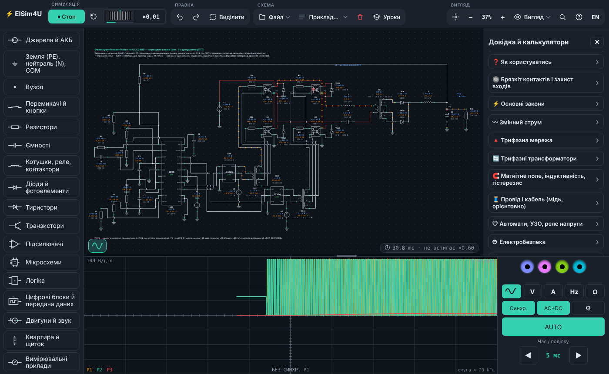

# ⚡ ElSim4U — симулятор електричних кіл

Збирайте схеми і дивіться, як вони працюють: струми, напруги, осцилограф, мультиметр — прямо в браузері, без встановлення.

**▶ Запустити: https://xask1-lab.github.io/elsim4u/**

## Що вміє

- Резистори, конденсатори, котушки, трансформатори, діоди, тиристори, транзистори, операційні підсилювачі, логіка
- ШІМ-контролери (UCC3895, TL494, SG3525, L6562), драйвери, імпульсні блоки живлення, коректор коефіцієнта потужності
- Частотний перетворювач і плавний пуск, двигуни, реле й контактори, автомати та УЗО
- Осцилограф, мультиметр, режим «реальних» елементів, які можуть перегоріти
- Готові приклади, уроки, довідка і калькулятори
- Українська та англійська мови, світла і темна тема, працює на ПК і телефоні

## Як користуватись

Відкрийте посилання вище — і все. Програма — це один файл `index.html`, його також можна завантажити й відкрити з диска.

## Встановлення як програми

ElSim4U можна встановити, щоб він мав свою іконку і працював без інтернету:

- **ПК (Chrome, Edge) і Android:** «Вигляд» → «Встановити програму» або значок встановлення в адресному рядку / меню браузера.
- **iPhone, iPad:** відкрийте сайт у Safari → «Поділитися» → «На екран „Додому“».

Іконку (4 варіанти) можна вибрати у «Вигляді» перед встановленням. Нові версії підтягуються самі, щойно є інтернет.

---

**ElSim4U — electric circuit simulator.** Build circuits and watch them work right in the browser: currents, voltages, oscilloscope, multimeter. Ukrainian and English interface. [Open the app](https://xask1-lab.github.io/elsim4u/).

---

© 2026 Xask1. Усі права захищено. / All rights reserved.
